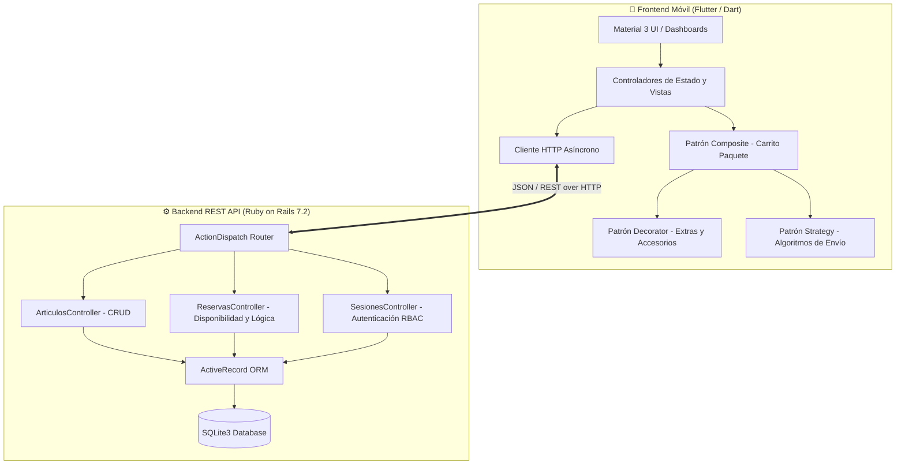
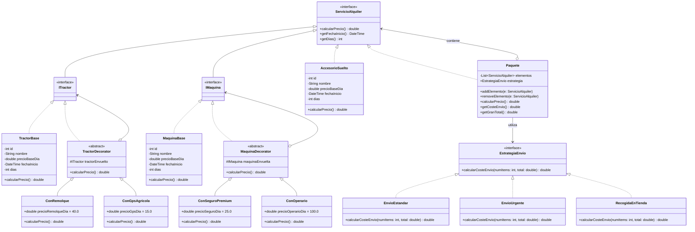

# 🚜 AgroRent – Plataforma de Alquiler de Maquinaria Pesada y Agrícola

[](https://flutter.dev)
[](https://dart.dev)
[](https://rubyonrails.org)
[](https://www.sqlite.org)
[](https://www.docker.com)
[](#-patrones-de-diseño-gof-implementados)
[](#-suite-de-pruebas-y-calidad-de-software)

Plataforma móvil y backend distribuido orientados a la gestión y reserva de maquinaria pesada, tractores agrícolas y accesorios de obra o labranza. Diseñada bajo principios de **Ingeniería del Software** y **Programación Orientada a Objetos (POO)**, la aplicación implementa de forma práctica tres patrones de diseño estructurales y de comportamiento del catálogo Gang of Four (**Decorator**, **Composite** y **Strategy**), desacoplando la lógica de negocio de la interfaz de usuario e integrando un control estricto de concurrencia y disponibilidad en tiempo real.

---

## 👥 Equipo de Desarrollo y Autoría

Este proyecto fue concebido, diseñado e implementado en colaboración por un **equipo de 3 ingenieros de software**:

| Desarrollador | Rol Principal | Contribuciones Clave |
| :--- | :--- | :--- |
| **Marcos García**  | **Software Architect & Full-Stack Developer** | • Diseño e implementación de los patrones de diseño GoF (**Decorator**, **Composite**, **Strategy**) en Flutter.<br>• Integración de la lógica de negocio en el backend Rails (cálculo dinámico de precios y validación de disponibilidad).<br>• Detección y prevención de colisión de fechas en reservas (HTTP 409 Conflict).<br>• Desarrollo de la suite de pruebas unitarias automatizadas para los patrones de diseño. |
| **Javier Miñan** | **Backend Specialist & Data Modeler** | • Modelado del esquema relacional en ActiveRecord y migraciones.<br>• Implementación de controladores RESTful (CRUD de Artículos y Sesiones).<br>• Creación de fixtures y pruebas de integración para endpoints de la API. |
| **German Delgado** | **Frontend Developer & UX/UI Designer** | • Maquetación de interfaces móviles con Flutter Material 3.<br>• Flujos de navegación y autenticación condicional por roles (Cliente vs. Gestor).<br>• Vistas de catálogo interactivo, filtros de ocupación y gestión del carrito. |

---

## 🏗️ Arquitectura del Sistema

El sistema sigue una arquitectura cliente-servidor desacoplada:



---

## 🧩 Patrones de Diseño GoF Implementados

Uno de los pilares del proyecto es la aplicación rigurosa de patrones de diseño clásicos para resolver problemas reales del dominio de negocio sin generar acoplamiento ni explosión de clases:

### 1. Patrón Decorator (Estructural)
* **Objetivo:** Extender de forma dinámica las responsabilidades y costes de un equipo base (Tractor o Máquina) en tiempo de ejecución, permitiendo acumular múltiples extras sin alterar la clase original ni crear subclases por cada combinación.
* **Componentes:**
  * **Componente Base:** Interfaz `ServicioAlquiler` e interfaces tipadas `ITractor` e `IMaquina`.
  * **Componentes Concretos:** `TractorBase` y `MaquinaBase`.
  * **Decoradores Concretos de Tractor:**
    * `ConRemolque` (+40.00 €/día)
    * `ConGpsAgricola` (+15.00 €/día)
  * **Decoradores Concretos de Máquina:**
    * `ConSeguroPremium` (+25.00 €/día)
    * `ConOperario` (+100.00 €/día)
* **Fórmula Recursiva:** Cada decorador delega el cálculo base en el objeto envuelto y añade el suplemento correspondiente multiplicado por los días:
  $$\text{PrecioTotal} = \text{precioBase} \times \text{días} + \sum (\text{precioExtra}_i \times \text{días})$$

### 2. Patrón Composite (Estructural)
* **Objetivo:** Tratar de manera uniforme objetos individuales (un tractor, una máquina o un accesorio) y composiciones jerárquicas de objetos (el paquete o carrito completo de alquiler).
* **Componentes:**
  * **Componente:** `ServicioAlquiler` define la interfaz común con `calcularPrecio()`, `getFechaInicio()` y `getDias()`.
  * **Hojas (Leaves):** `TractorBase` (o decorado), `MaquinaBase` (o decorado) y `AccesorioSuelto`.
  * **Compuesto (Composite):** Clase `Paquete`. Gestiona una colección `List<ServicioAlquiler>`, calcula el subtotal iterando recursivamente sobre sus hijos y coordina el cálculo del envío a través de la estrategia inyectada.

### 3. Patrón Strategy (Comportamiento)
* **Objetivo:** Definir una familia de algoritmos para el cálculo del envío y logística de transporte, encapsular cada algoritmo y hacerlos intercambiables en tiempo de ejecución según la preferencia del cliente.
* **Estrategias Disponibles:**
  * **`EnvioEstandar`:** $50.00\text{ € (fijo)} + (10.00\text{ €} \times N\text{ artículos})$.
  * **`EnvioUrgente` (24h):** $120.00\text{ € (fijo)} + (15.00\text{ €} \times N\text{ artículos})$.
  * **`RecogidaEnTienda`:** $0.00\text{ €}$ (gratuito en delegación).
* **Flexibilidad:** El carrito `Paquete` recibe una instancia de `EstrategiaEnvio` que puede conmutarse al vuelo sin modificar una sola línea del código del carrito.

---

## 📐 Diagrama de Clases UML

A continuación se muestra el modelado de clases que rige el diseño de los patrones en la solución:



*(El esquema gráfico original se encuentra disponible en [`documentos/uml.png`](documentos/uml.png)).*

---

## ⚡ Características y Flujos Principales

### 🔐 1. Autenticación y Control de Acceso Basado en Roles (RBAC)
* Inicio de sesión seguro gestionado por Rails con `has_secure_password` (`bcrypt`).
* Redirección automática a dashboards específicos según el rol del usuario:
  * **Rol Cliente:** Acceso a catálogo, configuración de maquinaria, carrito de compra, cálculo logístico, historial y cancelaciones.
  * **Rol Gestor / Administrador:** Acceso al panel de control de inventario con operaciones CRUD completas y monitorización global de reservas.

### 🚜 2. Catálogo Interactivo y Prevención de Solapamiento
* **Visualización de Disponibilidad en Tiempo Real:** Las tarjetas de catálogo identifican si un equipo tiene periodos reservados activos.
* **Bloqueo Preventivo en Calendario:** Al seleccionar fechas, el sistema comprueba los rangos ocupados y previene la selección de fechas inválidas.
* **Validación de Concurrencia en Backend (HTTP 409 Conflict):** La API Rails valida que ningún artículo del carrito se solape en el rango (`fecha_inicio <= fin AND fecha_fin >= inicio`). En caso de conflicto, la transacción se aborta de manera atómica informando al usuario de los equipos específicos no disponibles.

### 🛒 3. Carrito Compuesto y Configuración Modular
* Añadir múltiples equipos con distintas combinaciones de decoradores en un único paquete.
* Desglose visual en el carrito con opción de editar accesorios o eliminar líneas de pedido.
* Recálculo instantáneo del gran total combinando subtotal de alquiler y estrategia de transporte.

### 📅 4. Historial Personal y Política de Cancelación
* Consulta del historial de alquileres personales categorizado entre reservas en curso/pasadas y **reservas futuras**.
* **Cancelación de Reservas Futuras:** El cliente puede cancelar cualquier reserva cuya fecha de inicio sea posterior a la actual. El backend elimina el periodo reservado y libera inmediatamente las fechas en el calendario para otros clientes.

### 🛠️ 5. Panel CRUD para Gestores
* **Create:** Alta de nueva maquinaria indicando denominación, categoría (`Tractor`, `Maquina`, `AccesorioSuelto`) y tarifa base diaria.
* **Read:** Listado exhaustivo del catálogo y monitorización de todas las reservas de la plataforma.
* **Update:** Modificación de tarifas, nombres o categorías.
* **Delete:** Baja física de maquinaria con eliminación en cascada (`dependent: :destroy`) de sus periodos de ocupación históricos.

---

## 🧪 Suite de Pruebas y Calidad de Software

El proyecto cuenta con suites de pruebas automatizadas que cubren tanto la capa lógica en Flutter como la capa de persistencia y API en Ruby on Rails.

### Pruebas Unitarias de Patrones (Flutter / Dart)
Ubicadas en `alquiler_maquinaria_app/test/widget_test.dart`:
* ✅ **Decorator Test:** Valida la cadena de envoltura (`TractorBase` + `ConRemolque` + `ConGpsAgricola`) asegurando la acumulación exacta del precio diario:
  $$\text{Base } (150€ \times 2d) + \text{Remolque } (40€ \times 2d) + \text{GPS } (15€ \times 2d) = 410.00\text{ €}$$
* ✅ **Strategy Test:** Verifica las tres fórmulas de envío frente a diferentes cantidades de artículos y combinaciones de costes fijos/variables.
* ✅ **Composite Test:** Comprueba el contenedor `Paquete`, la suma recursiva de elementos heterogéneos y el intercambio dinámico de la estrategia de envío en caliente recalculando el gran total.

Para ejecutar los tests de Flutter:
```bash
cd alquiler_maquinaria_app
flutter test
```

### Pruebas de Integración y Controladores (Ruby on Rails)
Ubicadas en `alquiler_maquinaria_api/test/controllers/`:
* ✅ `articulos_controller_test.rb`: Valida las 4 operaciones CRUD (`GET`, `POST`, `PATCH`, `DELETE`) sobre `/articulos` con asertos en base de datos (`assert_difference`).
* ✅ `reservas_controller_test.rb`:
  * Verificación de creación de reservas con decoradores y envío estándar.
  * Prevención estricta de solapamiento de fechas retornando `HTTP 409 Conflict`.
  * Verificación de cálculo con envío urgente y recogida en tienda.

Para ejecutar los tests de Rails:
```bash
cd alquiler_maquinaria_api
bin/rails test
```

---

## 🚀 Guía de Instalación y Puesta en Marcha

### Prerrequisitos
* [Flutter SDK](https://flutter.dev) (versión 3.10 o superior)
* [Ruby](https://www.ruby-lang.org) (versión 3.2 o superior) y Bundler
* [SQLite3](https://www.sqlite.org)
* *(Opcional)* [Docker](https://www.docker.com) para desplegar el backend en contenedor.

---

### Paso 1: Configurar y Arrancar el Backend (Ruby on Rails API)

#### Opción A: Ejecución Local
```bash
cd alquiler_maquinaria_api

# 1. Instalar dependencias
bundle install

# 2. Configurar la base de datos y alimentar datos iniciales (seeds)
bin/rails db:migrate
bin/rails db:seed

# 3. Iniciar el servidor Rails (por defecto en http://localhost:3000)
bin/rails server
```

#### Opción B: Ejecución con Docker
```bash
cd alquiler_maquinaria_api
docker build -t maquinaria-api .
docker run -p 3000:3000 maquinaria-api
```

---

### Paso 2: Ejecutar la Aplicación Móvil (Flutter)

```bash
cd alquiler_maquinaria_app

# 1. Obtener los paquetes y dependencias de Dart
flutter pub get

# 2. Ejecutar los tests para comprobar integridad
flutter test

# 3. Arrancar la aplicación (en emulador Android, iOS, Chrome o Desktop Linux/macOS)
flutter run
```

---

### 🔑 Credenciales de Prueba Preconfiguradas

La base de datos incluye dos perfiles de prueba listos para usar generados por `db/seeds.rb`:

| Rol | Correo Electrónico | Contraseña | Vistas y Permisos |
| :--- | :--- | :--- | :--- |
| **Administrador / Gestor** | `admin@maquinaria.com` | `admin123` | Panel CRUD de Artículos, creación, borrado y monitorización global de alquileres. |
| **Cliente** | `user@gmail.com` | `user123` | Catálogo interactivo, configuración de extras, carrito con cálculo logístico e historial personal. |

---

## 📁 Estructura del Repositorio

```text
.
├── README.md                      # Documentación técnica principal del proyecto
├── .gitignore                     # Reglas de exclusión de binarios, temporales y credenciales
├── documentos/                    # Especificaciones de ingeniería de software
│   ├── requisitos.md              # Requisitos funcionales (RF) y no funcionales (RNF)
│   ├── pruebas.md                 # Documentación y matriz de casos de prueba
│   └── uml.png                    # Diagrama de clases estructural del sistema
├── alquiler_maquinaria_api/       # Backend REST API en Ruby on Rails 7.2
│   ├── app/
│   │   ├── controllers/           # Controladores REST (articulos, reservas, sesiones)
│   │   └── models/                # Modelos ActiveRecord (Articulo, AlquilerPeriodo, Usuario)
│   ├── config/routes.rb           # Enrutamiento de endpoints HTTP
│   ├── db/
│   │   ├── migrate/               # Migraciones de esquema de base de datos
│   │   ├── schema.rb              # Esquema canónico de base de datos
│   │   └── seeds.rb               # Sembrado inicial de catálogo y usuarios de prueba
│   ├── test/                      # Tests automatizados de controladores y modelos
│   ├── Dockerfile                 # Contenedorización para despliegue
│   └── Gemfile                    # Dependencias de Ruby y gemas
└── alquiler_maquinaria_app/       # Frontend móvil multiplataforma en Flutter / Dart
    ├── lib/
    │   ├── main.dart              # Punto de entrada de la aplicación móvil
    │   ├── login_screen.dart      # Pantalla de login y redirección por roles
    │   ├── cliente_dashboard.dart # Panel interactivo del cliente (catálogo, carrito, historial)
    │   ├── gestor_dashboard.dart  # Panel del gestor (CRUD de maquinaria y reservas)
    │   ├── servicio_alquiler.dart # Interfaces base para componentes y decoradores
    │   ├── componentes_base.dart  # Implementaciones concretas (TractorBase, MaquinaBase, Accesorio)
    │   ├── decoradores.dart       # Implementación del Patrón Decorator (Remolque, GPS, Seguro, Operario)
    │   ├── composite.dart         # Implementación del Patrón Composite (Clase Paquete / Carrito)
    │   └── estrategia_envio.dart  # Implementación del Patrón Strategy (Estándar, Urgente, Recogida)
    ├── test/widget_test.dart      # Tests unitarios de los patrones de diseño en Flutter
    └── pubspec.yaml               # Dependencias del proyecto Flutter
```

---

## 📜 Licencia

Este proyecto se distribuye bajo la licencia **MIT**. Consulte el archivo `LICENSE` para más información.
